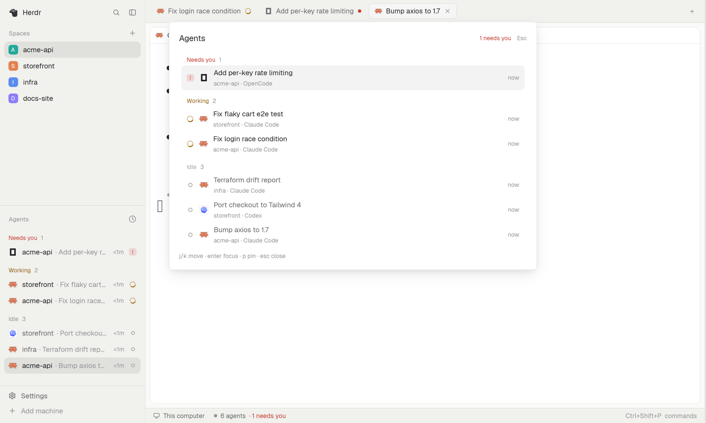

# Agent groups

A keyboard-first popup that answers one question: which agent needs me? Agents are grouped Needs you, Working,
Done, Idle, newest first; you pin the ones you care about.

## What you see

A white popup, 680 px wide, 40 px below the top edge, at most 80% of the window tall.

- Header: "Agents" on the left; on the right a red "N needs you" (only when N > 0) and "Esc".
- Group headings in the group's colour with a count: **Needs you** (red), **Working** (amber), **Done** (green),
  **Idle** (grey). Empty groups are not drawn.
- Each agent is a two-line row: a status marker on the left (red `!` tile, amber ring, green check, grey circle), the
  agent's logo, its task title on line one, and "space · agent name" in grey on line two; the time since it last
  changed ("now", "12m", "3h") on the right. The selected row has a light grey background.
- Footer: "j/k move · enter focus · p pin · esc close".

## How it behaves

- Groups come from the status the agent reports (`blocked`, `working`, `done`, `idle`); inside a group the newest
  change comes first. It reads herdr-core's status timestamps, never transcripts.
- `j`/`k` move; `enter` or a click focuses that agent's terminal and closes the popup; `p` pins (pins lead their
  group and show a small "pinned" chip); `esc` or `q` closes.
- A finished agent turns idle once anybody looks at it, on any window; the popup follows.

## Built from

- `mods/agent-groups/` with `mod.json` = `{ "place": "none", "title": "Agent groups", "overlay": { "kind": "popup",
  "at": "top", "offset": 40, "width": 680, "height": 0.8 } }`, opened with `mod.open:agent-groups`
  (`"ctrl-alt-a": "mod.open:agent-groups"` in `keys.json`).
- `groups.js` (grouping, ordering, `ago()`, pure and tested) and `main.js` (the view; imports `herdr`, `gpui-kit`).
- Reads the app's own agent list and status. Pinning calls the app's `terminal.pin` command; nothing else changes but focus.

## Watch out

- Status words are exactly `blocked`, `working`, `done`, `idle`; a plain program that reports no status is not an agent
  and is not listed.
- "now" is under a minute; do not show seconds.
- Focus must go to the terminal, not just the tab, or typing lands in the wrong pane.

## Done when

1. `herdr-app check mods/agent-groups` passes.
2. Open with six agents (1 blocked, 2 working, 3 idle): three headings in the order Needs you, Working, Idle.
3. `j` then `enter` focuses the second agent and closes the popup.
4. `p` on a row moves it to the top of its group and it stays there after reopening.
