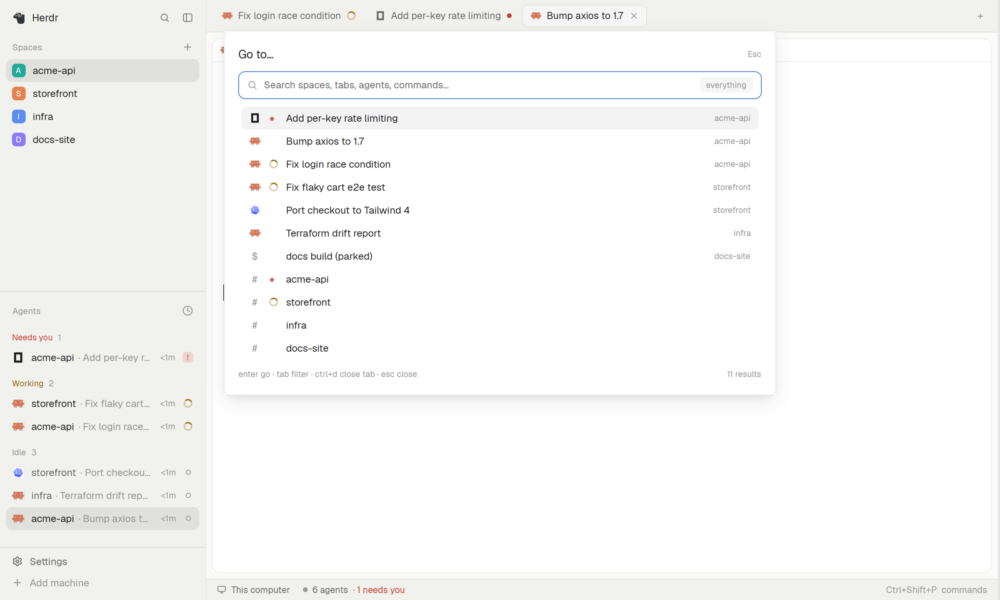

# Command bar

One search box that opens over the window and reaches everything: every space, tab, agent, terminal, machine and
app command. Agents that need you come first. Press the key, type a few letters, press enter.

## What you see

A white popup, 720 px wide, hanging 40 px below the top edge and at most 80% of the window tall, centered over the
live window (the app stays visible behind it).

- Header: "Go to…" on the left, "Esc" on the right.
- A one-line search field with a magnifier and the placeholder "Search spaces, tabs, agents, commands…". On its right
  a small grey chip names the kind being searched ("everything" at rest).
- The result list, one row each: the kind's icon (an agent's own logo, `#` for a space, `$` for a shell), a status dot
  when the thing is an agent (red = needs you, amber ring = working), the title, and the space on the right in grey.
  The selected row has a light grey background.
- Footer: "enter go · tab filter · ctrl+d close tab · esc close" and "N results".

## How it behaves

- Order at rest: agents that need you, then finished ones, then recents (a remembered list of past picks), then the
  rest. The place you are in never comes first.
- Typing is a fuzzy search; a space separates terms and all must match; smart case. A one-letter prefix (`s a t p m c`)
  followed by a space or colon limits the kind: `s web`, `a:claude`. A prefix that matches nothing searches everything.
- `>` or `:` opens the command palette: every app command and key binding with its keys, read from the app's own
  commands and keys, so it never lists a key you did not bind. `@` agents, `%` named terminals, `!` only what needs you.
- Up/down (also ctrl+n/p, ctrl+j/k) move; tab and shift+tab cycle the kind; enter goes (shows a space, focuses an
  agent, runs a command); esc closes. ctrl+d twice closes the selected tab; ctrl+r renames it.
- `modal: true` makes it vim-like (`j`/`k`, `g`/`G`, `/` to search).

## Built from

- `mods/command-bar/` with `mod.json` = `{ "place": "none", "title": "Command bar", "overlay": { "kind": "popup",
  "at": "top", "offset": 40, "width": 720, "height": 0.8 } }`. Opened with `mod.open:command-bar` bound in `keys.json`
  (`"ctrl-alt-o": "mod.open:command-bar"`).
- `fuzzy.js` (matching and scoring, pure), `items.js` (builds the rows from `spaces()`, `panes()`, `commands()`,
  `keys()` and agent status; pure and tested), `main.js` (the only file that imports `herdr` and `gpui-kit`).
- Reads the app's own spaces, panes and agent status; changes nothing except through the command you pick. Recents live in shared state
  `command-bar.mru` (`mru` config, default 30).
- Config `config/command-bar.json`: `modal` (false), `scope` (`all`), `mru` (30).

## Watch out

- Palette rows come from the app, so a layout or theme the person never installed does not appear. Do not hardcode
  commands.
- Enter on a palette split fills only the command's first argument: you get a shell, not the agent their own key starts.
- A prefix letter only counts when followed by a space or colon, otherwise `a` is just a letter to search for.
- The popup must not steal the window's size: `height` is a fraction (0.8), `width` is pixels.

## Done when

1. `herdr-app check mods/command-bar` passes.
2. `mod.open:command-bar` opens the popup; pressing it again closes it.
3. With one agent blocked, one working and one idle, the blocked one is the first row and has a red dot.
4. Typing `a:claude` leaves only agent rows whose name or title match; `>` shows commands with their keys.
5. Enter on a tab row shows that tab.
