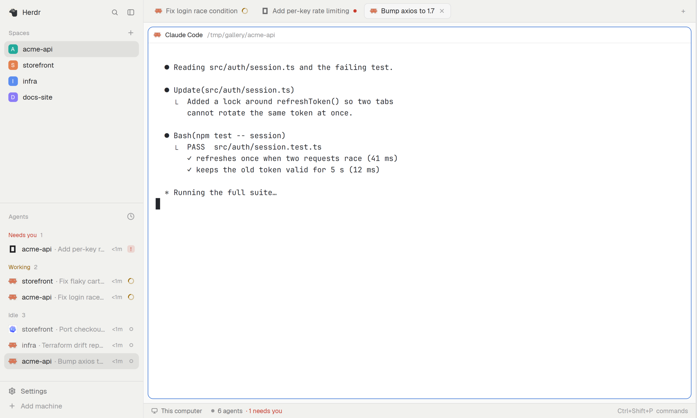

# Tab titles

Tabs that name themselves. The agent's own task title becomes the tab name, so the tab bar, the sidebar and the
command bar show the work ("Fix login race condition"), not a number.

## What you see

Nothing new is drawn. The tab bar across the top of the window shows each tab as its agent's logo, its task title and
a status dot (amber ring working, red dot needs you); the active tab has a raised rounded background and a close ×.
The same names appear in the sidebar's agent list and in the command bar.

## How it behaves

- A tab nobody named takes its agent's title once the title has held still for `settle_ms` (3000 by default; no
  flicker while the agent is typing).
- A tab it named stays its own while the name is the one it wrote. Rename it yourself and it is yours for good; clear
  the name and it can be retitled.
- A tab you named is never touched.
- A tab with several agents is left alone, unless `multi_agent_titles` is on: then one small request to any
  OpenAI-compatible endpoint names it from the agents' titles (`llm_url`, `llm_model`, token from `llm_key`,
  `llm_key_env` or `llm_key_file`).
- `follow_new_sessions` keeps retitling as the title changes; `max_length` (40) shortens; `only_spaces` and
  `exclude_spaces` are regexes over space names.

## Built from

- `mods/tab-titles/` with `mod.json` `{ "place": "none", "title": "Tab titles" }`: it draws nothing and must stay
  alive, so the layout gives it a zero-size block:
  `{ "id": "tab-titles", "type": "block", "size": { "px": 0 }, "content": { "mod": "tab-titles" } }`.
- `titles.js` (pure rules: clean the title, decide, plan, request body, parse reply), `llm.js` (the model client, copied
  from `shared/`), `config.js` and `lease.js` (copied from `shared/`; the lease makes one copy act at a time),
  `main.js` (reads tab and terminal titles, calls the app's tab rename command).
- State (which tab names it wrote) lives in shared state `tab-titles.state`. Config `config/tab-titles.json`.
- It runs `printenv` to find a token you pointed it at, and makes one HTTPS request only if `multi_agent_titles` is on.

## Watch out

- Titles that are just a terminal's address are not task titles and are ignored.
- A copy that is not on screen re-checks every 5 s; one on screen reacts to every change. Only one copy acts.
- The token is never shown in a panel or an error.

## Done when

1. `herdr-app check mods/tab-titles` passes.
2. A new unnamed tab whose terminal sets the title "Fix login race condition" is renamed to that after `settle_ms`.
3. Renaming that tab by hand stops it from being retitled; a tab created with a name is never renamed.
4. With `multi_agent_titles` off, a tab with two agents keeps its number.
