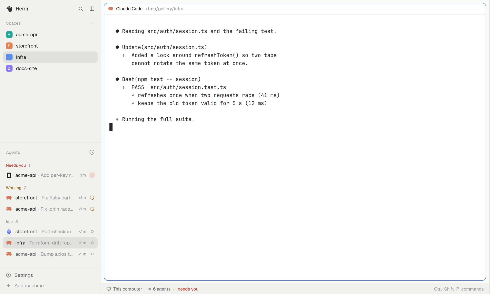

# Tab tools

The small things the app has no setting for. It draws nothing; it hides the tab bar on one-tab spaces, moves tabs
by key, and opens the worktree dialogs.

## What you see

In a space with a single tab the tab bar is gone and the terminal starts right under the top edge (the preview shows
the `infra` space, one tab). The moment a second tab exists the bar comes back.

## How it behaves

- `hide_bar_when_single_tab` (default `false`): hides the tab bar while the shown space has one tab; checked on a 1 s timer
  (a hidden block may not render) and after each key command.
- Relative tab moves, bound in `keys.json`: `"alt-shift-h": "tab-tools.tab_move:-1"`,
  `"alt-shift-l": "tab-tools.tab_move:1"` (the app's own `tab.move` is absolute).
- Worktree dialogs on a key: `"tab-tools.worktree:new"` and `"tab-tools.worktree:open"`.
- `tab_bar_id` (default `"tabs"`) is the layout node of the tab bar to hide.

## Built from

- `mods/tab-tools/` with `mod.json` `{ "place": "none", "title": "Tab tools" }` and a zero-size layout block
  `{ "id": "tab-tools", "type": "block", "size": { "px": 0 }, "content": { "mod": "tab-tools" } }`.
- `tools.js` (pure: `parseCommand`, `moveTab`, `barCommand`, `findNode`), `config.js` (copied from `shared/`), `main.js`
  (uses `nextCommand()`, `layout()`, `run()`, `openOverlay()`).
- Config `config/tab-tools.json`. It runs layout and tab commands and nothing else; no network.

## Watch out

- It must stay alive, so the zero-size block is required; without it the keys do nothing.
- If the layout's tab bar has another id, set `tab_bar_id`, or nothing is hidden.
- Moves clamp at the ends; `tab_move:1` on the last tab does nothing.

## Done when

1. `herdr-app check mods/tab-tools` passes.
2. With `hide_bar_when_single_tab: true`, a one-tab space shows no bar and a two-tab space shows it.
3. `tab-tools.tab_move:1` moves the shown tab one place to the right; on the last tab it does nothing.
